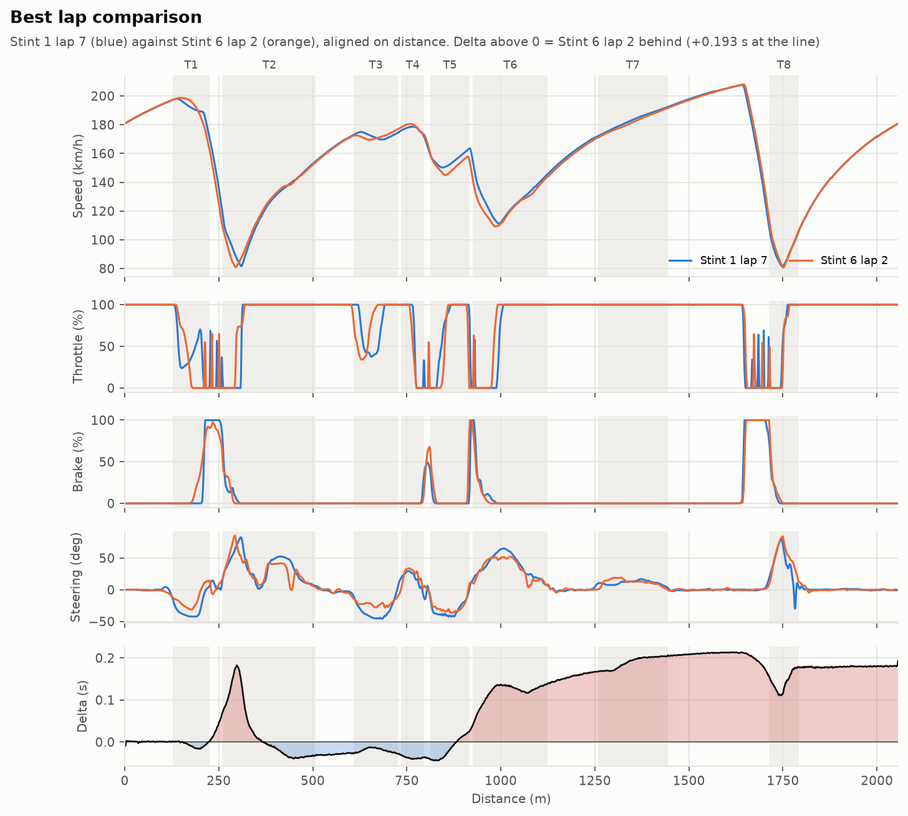
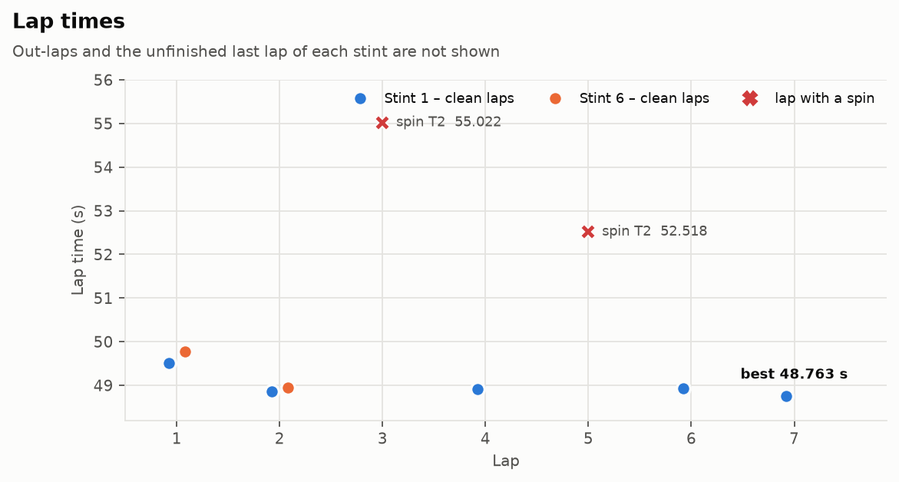
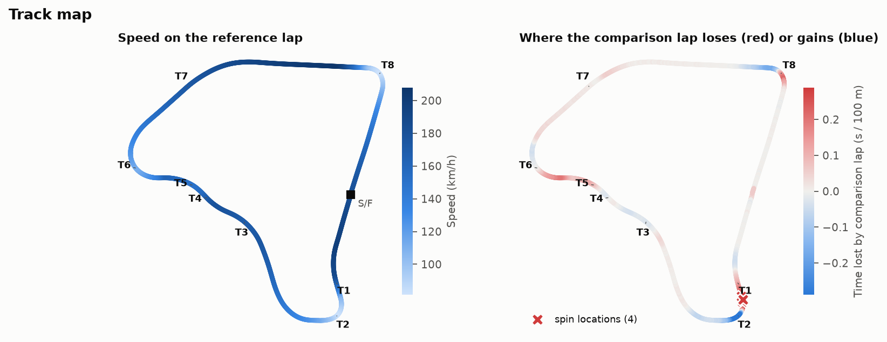
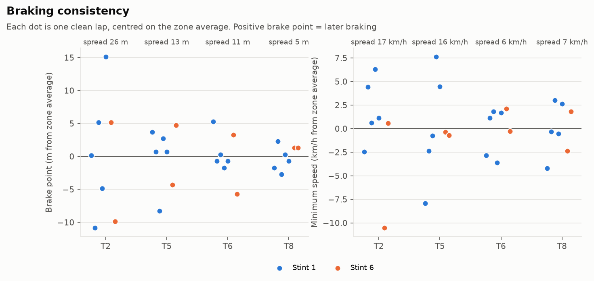
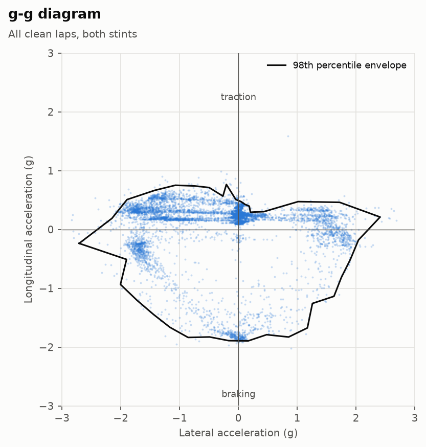
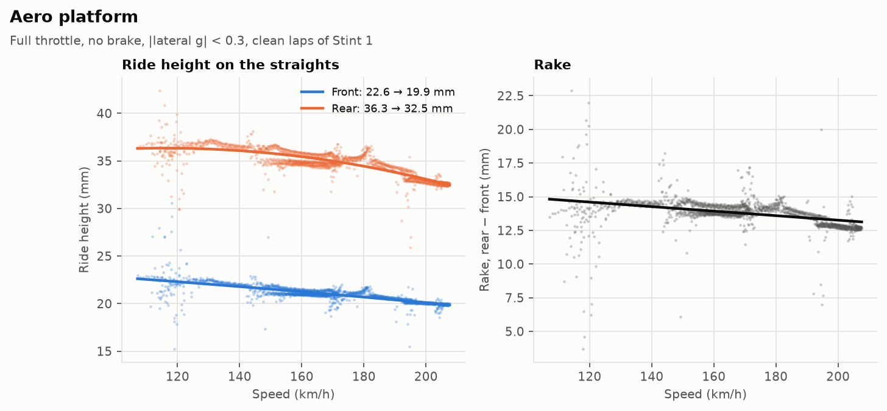
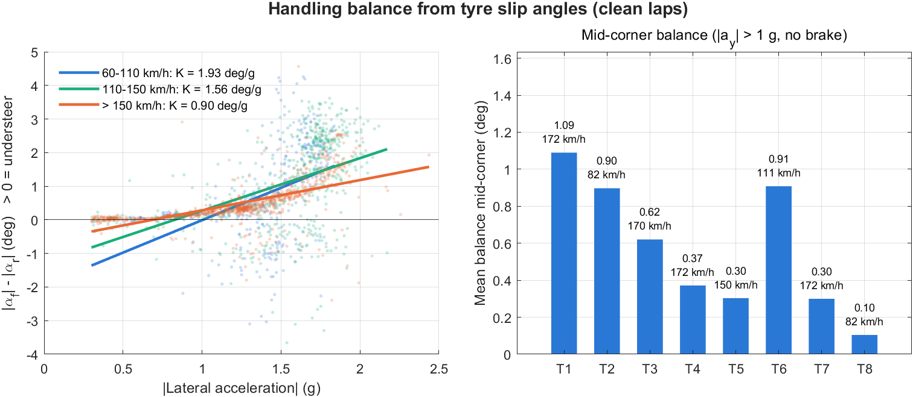
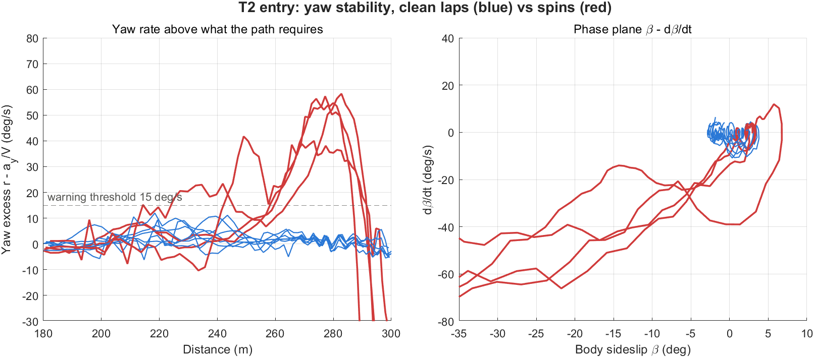

# MoTeC telemetry analysis – F4 car, Assetto Corsa

<!-- Draft – not published yet -->

A Python and MATLAB toolchain that reads raw MoTeC `.ld` logs, splits them into laps and turns them into the kind of debrief a performance engineer gives a driver after a session: where the time is, why the car spun, what the tyres and the platform are doing.

The data comes from two practice stints of a single driver in a simulator. The code does not depend on it: it would run on any `.ld` export with the same channels.



## Key findings

- **All four spins of the two stints happen at the same spot**: the entry of T2, a 2nd-gear right-hander that follows a flat-out left kink. The car rotates while the driver is still braking hard and downshifting. Rear wheel slip under braking is higher on the spin laps (the best lap is the one clean exception), and a simple yaw-rate indicator (MATLAB part) flags every spin 10 to 45 m before the car is sideways, with no false alarm on the 7 clean laps.
- **T2 is also where most of the lap time is.** An ideal lap built from the best corner segments of all clean laps is 48.50 s, 0.26 s under the best lap (48.763 s). 0.15 s of that comes from T2 alone. In T2, the laps that braked earliest tended to carry more minimum speed and were faster.
- **Steady-state balance is understeer** everywhere on the lap (front slip angle larger than rear mid-corner), so the instability is a corner-entry problem, not a balance problem. That points to entry tools: brake bias, engine braking, how the brake is released.
- **Tyres**: the circuit is mostly right-handers, and it shows. The front-right runs about 15 °C colder (core) than the front-left and barely warms up during the stint. All four tyres run 6–8 °C hotter on the inner edge than on the outer edge.

The full debrief, with recommendations for the driver and the setup, is in **[REPORT.md](REPORT.md)**.

## Data

| | |
|---|---|
| Source | Assetto Corsa 1.16.4, exported to MoTeC i2 with ACTI 1.1.2 |
| Car | `rss_formula_rss_4_2024`, a Formula 4-type single-seater (mod) |
| Circuit | `actk_var`, 2 056 m (measured from the data) |
| Session | Practice, slick tyres, two stints recorded on two different days |
| Logging | 169 channels at 20 Hz |
| Driver | anonymised as *Driver A* |

Laps found in the files:

| Stint | Laps with a time | Clean laps | Best lap |
|---|---|---|---|
| Stint 1 | 7 (+ out-lap, + unfinished lap 8) | 5 | 48.763 s (lap 7) |
| Stint 6 | 2 (+ out-lap, + unfinished lap 3) | 2 | 48.946 s (lap 2) |

The raw `.ld` files are not published because their metadata contains the driver's name. The repository ships the processed, anonymised data instead: one CSV per lap with 69 of the 169 channels plus a few derived ones (lap distance, sideslip), in [`data/processed`](data/processed).

Things to keep in mind about this data:

- It is simulator data. Assetto Corsa's tyre and aero models are not a real F4, so the method is the point here, not the absolute values.
- Stint 6 has only two timed laps. Stint-to-stint comparisons rest on very few laps.
- The `Lap Invalidated` channel is always 0, even with four wheels off the track. Excursions are detected with `Num Tires Off Track` instead.
- At 20 Hz the time delta between two laps is only good to about ±0.01–0.02 s: the interpolated gap at the line is 0.193 s against an official 0.183 s.

## What the code does

```
.ld files ──► ld_reader ──► laps ──► export (anonymised CSV)
                                │
                                ├──► analysis ──► reports/tables/*.csv
                                │
                                └──► plotting ──► reports/figures/*.png
                                                       ▲
data/processed/*.csv ──► MATLAB (balance, yaw stability) ┘
```

1. **Reading the `.ld` format** (`src/telemetry/ld_reader.py`). The format is binary and undocumented. The reader follows the layout reverse-engineered by the open-source [ldparser](https://github.com/gotzl/ldparser) project: a header with pointers, then a linked list of channel descriptors, each pointing to its block of samples.
2. **Laps** (`laps.py`). Lap splitting, lap distance from Assetto Corsa's normalised track position (more stable between laps than integrating speed), gear signal cleaned of the neutral blips during shifts, body sideslip angle, and a status for every lap: out-lap, clean, incident (spin or excursion), incomplete.
3. **Analysis** (`analysis.py`):
   - laps resampled every metre so that two laps can be compared point by point, and time delta along the lap;
   - automatic corner detection from lateral acceleration (several corners here are flat out and have no speed minimum, so speed alone misses them);
   - time lost per corner, ideal lap from the best segments;
   - braking zones: brake point, peak pressure, entry and minimum speed, throttle pick-up;
   - g-g diagram and its envelope;
   - tyre temperatures across the tread, pressures and core temperatures lap by lap;
   - ride height against speed on the straights (aero compression, rake);
   - comparison of clean and spinning laps through the T2 entry.
4. **MATLAB** (`matlab/`), a vehicle-dynamics view that the Python part does not cover:
   - handling balance from tyre slip angles (|α<sub>f</sub>| − |α<sub>r</sub>|), understeer gradient per speed band and mid-corner balance per corner, using the linear bicycle model;
   - steering ratio estimated from the front toe signal;
   - yaw stability at T2: yaw rate compared with the yaw rate the path requires (a<sub>y</sub>/V), and the β – dβ/dt phase plane, to show how early a spin can be seen coming.

## Results

| | |
|---|---|
|  |  |
| Lap times. The two spin laps both lost the time in T2. | Where the best lap of Stint 6 loses 0.18 s to the best lap of Stint 1: mostly T5–T7. |
|  |  |
| Speed map, time gained/lost along the lap, spin locations. | Braking consistency: T2 brake point varies by 26 m between clean laps, T8 by 5 m. |
|  |  |
| T2 entry, clean laps against spins: yaw rate and rear slip angle take off around the downshift. | In T2, braking later did not pay: minimum speed did. |
|  |  |
| g-g diagram: about 2 g lateral, 1.8 g braking, 0.6 g traction. | Tyre temperatures: front-right cold, inner edges hotter everywhere. |
|  |  |
| Warm-up: the rear-left keeps heating until lap 5, the front-right never really comes in. | Aero platform: front −2.7 mm and rear −3.8 mm between 110 and 207 km/h. |

### MATLAB

| | |
|---|---|
|  |  |
| Understeer gradient per speed band, mid-corner balance per corner. | Yaw excess and phase plane at T2. |

## How to run it

Python 3.10 or newer.

```bash
git clone https://github.com/<user>/motec-telemetry-analysis.git
cd motec-telemetry-analysis
pip install -r requirements.txt

# on the published data
python scripts/run_all.py --from-csv

# on your own .ld files: put them in data/raw/ (file names containing "stint_<n>")
python scripts/run_all.py
```

Tables go to `reports/tables/`, figures to `reports/figures/`.

MATLAB (R2020b or newer, no toolbox needed): open the `matlab/` folder and run `run_matlab_analysis`. It reads `data/processed/` and `reports/tables/corners.csv`.

## Repository layout

```
├── data/
│   ├── raw/                 .ld files (not published)
│   └── processed/           one CSV per lap, laps.csv, sessions.json
├── src/telemetry/
│   ├── ld_reader.py         MoTeC .ld reader
│   ├── laps.py              lap splitting, distance, lap status
│   ├── analysis.py          comparisons, corners, braking, grip, tyres, incidents
│   ├── plotting.py          figures
│   └── export.py            anonymised CSV export
├── scripts/run_all.py       full pipeline
├── matlab/                  balance and yaw-stability analysis
├── reports/
│   ├── figures/
│   └── tables/
└── REPORT.md                engineering debrief
```

## Author

Julian Baulès, engineering student (INSA Centre Val de Loire), looking for a performance engineering internship in motorsport from April 2027.

## License

Code under the MIT license. The telemetry data is shared with the driver's agreement, for demonstration only.
