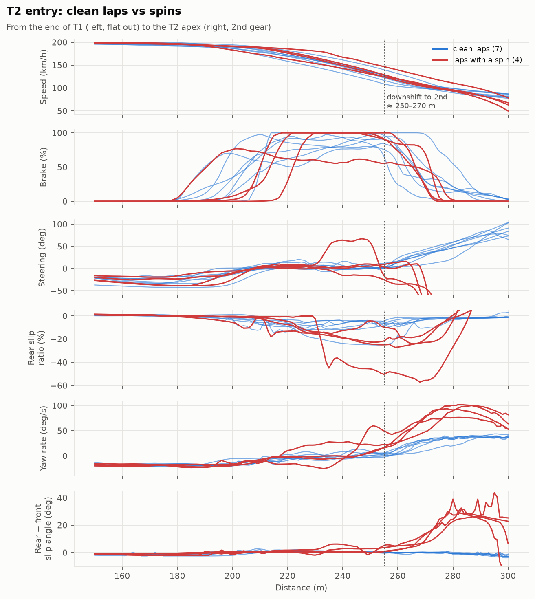
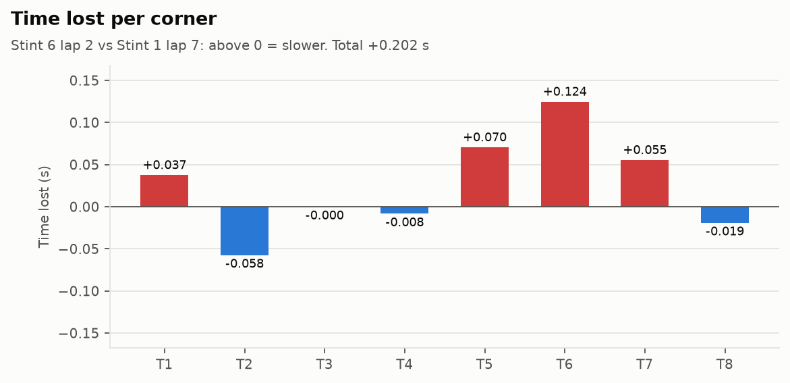
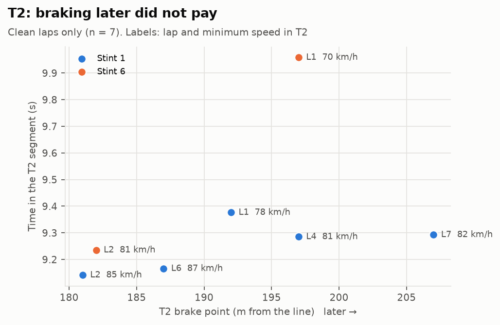
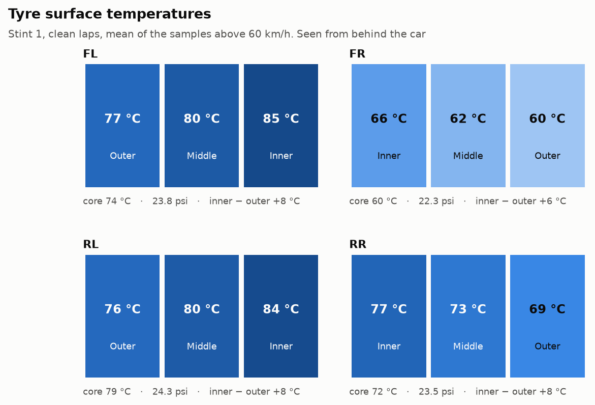
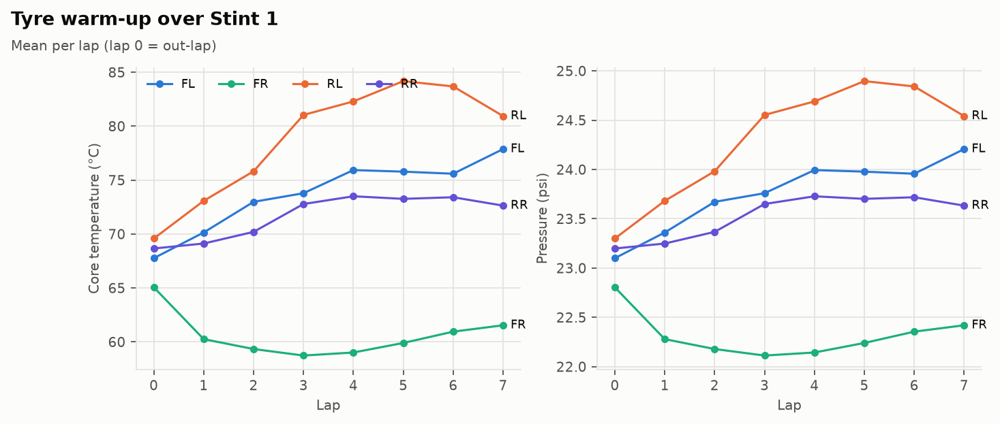

# Session debrief – Driver A, F4 (RSS Formula 4 2024), actk_var

Practice, slick tyres, Assetto Corsa. Stint 1 (9 laps logged) and Stint 6 (4 laps logged).
All numbers below come from `scripts/run_all.py` and `matlab/run_matlab_analysis.m`; the tables are in `reports/tables/`.

## 1. Summary

| | |
|---|---|
| Best lap | **48.763 s** (Stint 1, lap 7) |
| Best lap Stint 6 | 48.946 s (lap 2), +0.183 s |
| Ideal lap (best segments, clean laps) | **48.50 s**, 0.26 s available |
| Clean laps / timed laps | 7 / 9 |
| Spins | 4, all at T2 entry. Both stints end with one |

The pace is consistent: four of the five clean laps of Stint 1 are within 0.18 s. The problem is T2. It holds 0.15 s of the 0.26 s left on the table, and every spin of the session happened there, including the two that ended the stints.

## 2. T2 entry: what happens

T2 is a 2nd-gear right-hander (about 82 km/h at the apex) right after T1, a left kink taken almost flat at 190–200 km/h. Braking for T2 starts while the car is still loaded to the left from T1.

On the four spin laps:

- the car arrives at the same speed as on the clean laps (191–199 km/h at 180 m, both groups);
- the brake point is not the cause on its own: spins happened with brake points from 180 to 217 m, inside the range of the clean laps (181–207 m);
- yaw rate and the rear-minus-front slip angle start rising at 250–260 m, while the brake is still at 50–100 % and the 3rd-to-2nd downshift is happening (between 251 and 270 m on every lap);
- the rear slip ratio under braking is higher: −23 to −57 % on the spin laps against −9 to −15 % on six of the seven clean laps. The exception is the best lap (−25 %), which survived it.

So on every lap the car goes into T2 close to the limit of the rear axle: high brake pressure, engine braking from the downshift, and a direction change. On 4 laps out of 11 the rear let go. One lap (Stint 1, lap 8) is different: it arrived about 20 km/h faster at 260 m after the latest braking of the session (217 m), so that one is mostly an overspeed.

The MATLAB analysis gives an early-warning measure. If the yaw rate exceeds the rate the path requires (ay/V) by more than 15 deg/s, a spin follows. Every spin crossed that line 10 to 45 m (0.3 to 1.2 s) before the car was sideways. No clean lap went above 12 deg/s. The threshold was set on these same 11 laps, so it is a description of this session, not a validated detector.

Steady-state balance is understeer everywhere: mid-corner, the front slip angle is larger than the rear one in all eight corners, by 0.1° (T8) to 1.1° (T1). The car is not loose in the middle of the corner. The instability belongs to the entry phase.

## 3. Lap time

**Ideal lap.** Best segment of each corner over the seven clean laps:

| Corner | Best segment | From | Gain vs best lap |
|---|---|---|---|
| T1 | 4.608 s | Stint 6 L1 | 0.035 s |
| **T2** | **9.142 s** | **Stint 1 L2** | **0.151 s** |
| T3 | 3.584 s | Stint 1 L6 | 0.031 s |
| T4 | 1.494 s | Stint 6 L2 | 0.008 s |
| T5 | 2.667 s | Stint 1 L6 | 0.017 s |
| T6 | 7.148 s | Stint 1 L7 | – |
| T7 | 7.547 s | Stint 1 L7 | – |
| T8 | 12.248 s | Stint 6 L2 | 0.019 s |

**T2.** The best T2 (lap 2) braked at 181 m, the earliest of the session, and carried 85 km/h at the apex. The best lap braked at 207 m, 26 m later, and carried 82 km/h: 0.15 s slower through the segment. On the seven clean laps, a later brake point did not give a faster T2; minimum speed did. With only seven laps this is a trend, not a proof.

**Stint 6 against Stint 1.** The best lap of Stint 6 is 0.18 s down. It gains 0.06 s in T2 and loses about 0.25 s between T5 and T7: 5 km/h less at the T5 minimum (145 against 150 km/h), braking 5 m earlier for T6 with 2 km/h less at its apex, and the lower exit speed costs another 0.05 s along T7.

**T5.** Brake pressure in T5 varies from 49 to 90 % between laps, and minimum speed by 15 km/h. Lap 6 (56 % peak) carried 153 km/h and holds the best T5 segment, with lap 7 (49 %) close behind. The heavier applications (64–90 %) gave the lowest minimum speeds, 138–145 km/h.

## 4. Tyres

- Five of the eight corners are right-handers, which load the left-hand tyres. The front-left core runs at 74 °C against 60 °C for the front-right. The front-right actually cools down after the out-lap (65 → 59 °C) and stays around 60 °C for the whole stint, with its pressure stuck at 22.1–22.4 psi while the others rise by 0.5 to 1.6 psi.
- Inner edges are 6–8 °C hotter than outer edges on all four tyres. These are averages over the whole lap, straights included, where static camber alone heats the inner edge. Before touching camber, the spread should be measured in the corners only.
- The middle of the tread is within 1 °C of the average of the two edges on every tyre: no sign of a pressure far off target.

## 5. Platform

Between 110 and 207 km/h on the straights, the front ride height drops by 2.7 mm and the rear by 3.8 mm, so the rake goes from about 15 to 13 mm. The front touched 0 mm only twice in the stint, both at about 782 m (kerb at T4 exit), with no visible effect on the lap. Nothing to act on.

## 6. Recommendations

**Driver**

1. T2: aim for the brake point of laps 2 and 6 (181–187 m), brake in a straight line once T1 is done, and release the pedal progressively before adding steering for T2. Judge the corner on the apex speed (85 km/h is achievable), not on how late the braking was.
2. T2: try to complete the last downshift with the pedal already coming off. All spins started as the car went into 2nd under heavy braking.
3. T5: a lighter, shorter brake application. 50–60 % was enough on the best T5 laps.

**Setup** (to be tested on track; the simulator makes it cheap to check)

1. Brake bias is fixed at 54 % front. The rear slip under braking at T2 suggests trying 1–2 % further forward, and checking that the rears stop going past −20 % slip ratio.
2. If the mod gives access to engine braking or differential coast settings, reduce the engine braking on downshifts: it adds to the rear braking exactly where the car spins.
3. Front-right: on a mainly right-handed track it will stay cold. Hot, it runs 1.5 psi below the front-left. If the target hot pressure is the same for all four tyres, start the front-right higher by roughly that amount, then check after a run.

## 7. Limits of this analysis

- Simulator data, one driver, 11 laps. The mechanisms are plausible; the numbers are specific to this car model and this session.
- 20 Hz logging: interpolated time deltas are good to about ±0.01–0.02 s, and short events (kerb strikes, a shift) are only a few samples long.
- The unit of the slip ratio channel in this export could not be checked against wheel speeds exactly. It is used here to compare laps with each other, not as an absolute value.
- No setup sheet was available, apart from what the channels give (brake bias, static camber and toe can be read from the data).
